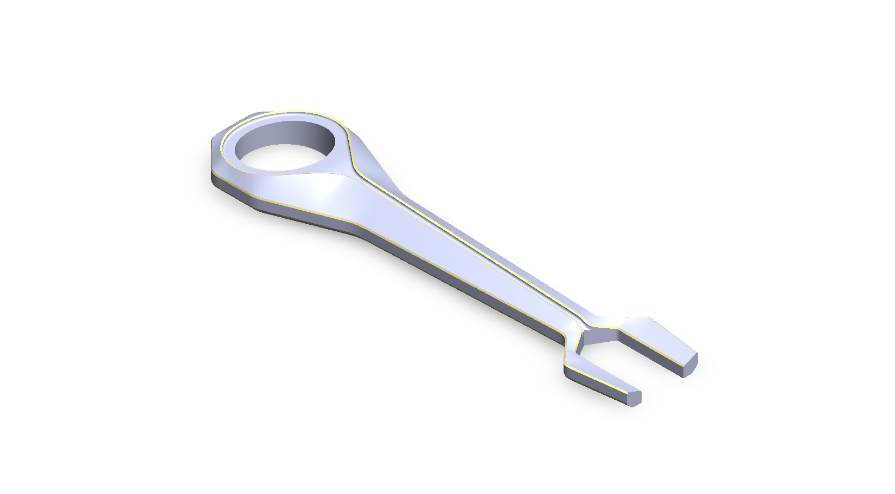
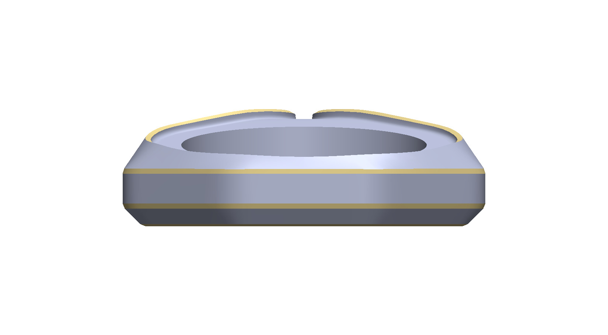
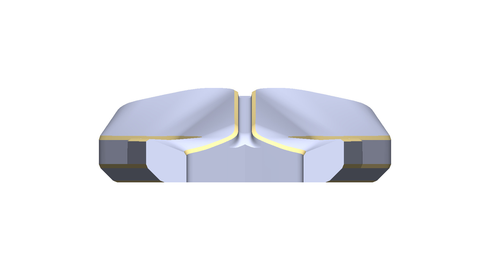
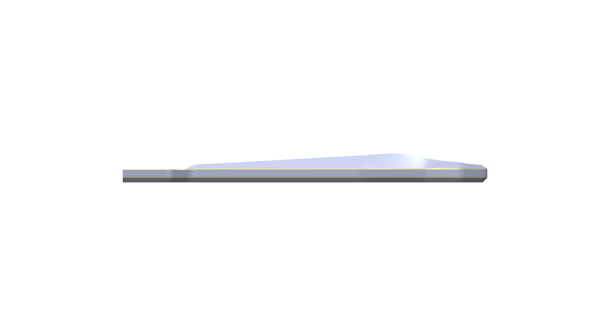
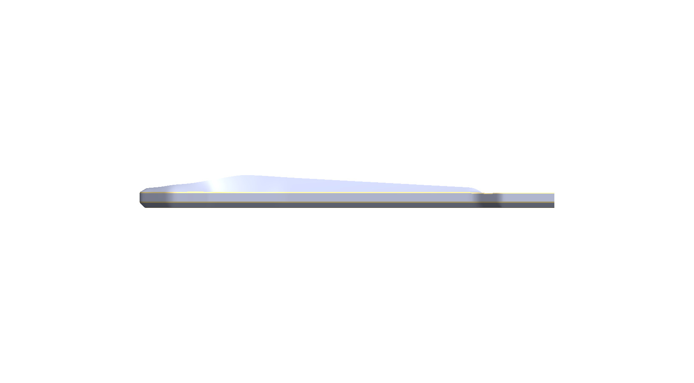
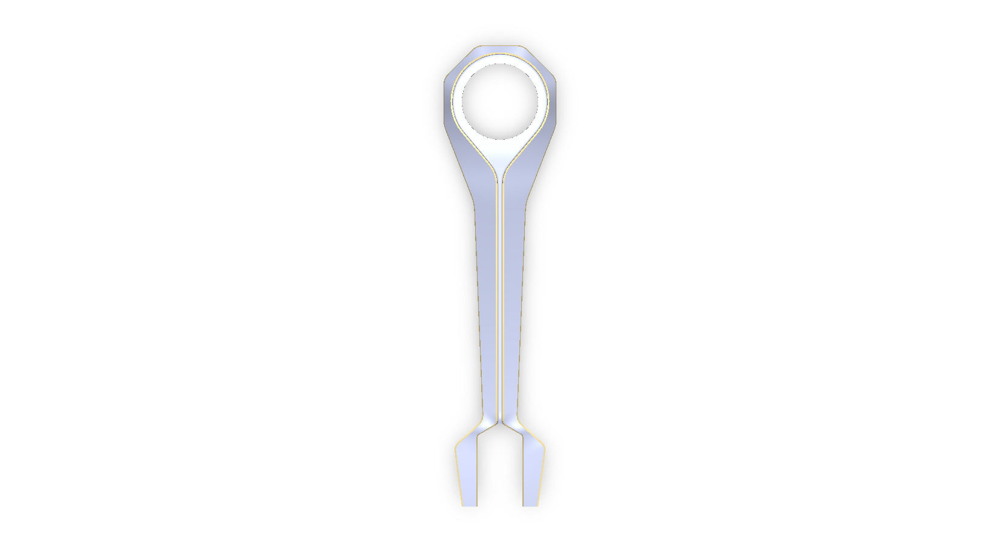
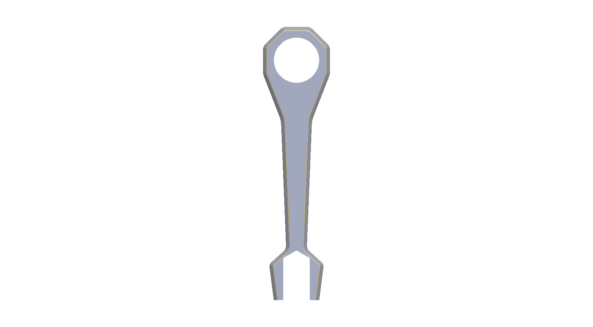
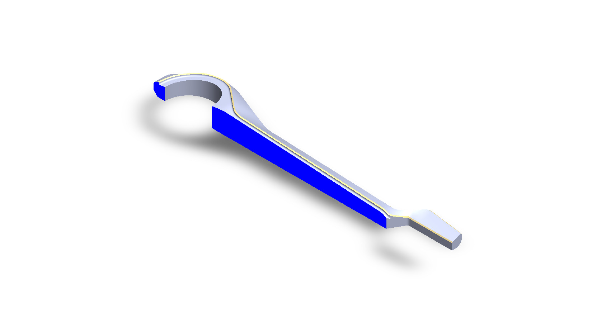
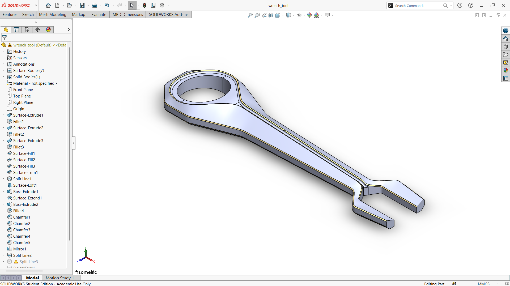

# A Flat Wrench with a Ring End and an Open Fork End

## Summary

A wrench is a hand tool that applies torque to turn nuts and bolts, and its shape decides which fasteners it can reach and how comfortably it can be used. This project explores how a double-ended wrench can be modeled computationally, from the head shapes to the handle.

The model is a flat wrench with two different ends. One end is a closed ring with a round opening, which surrounds a fastener fully. The other end is an open fork with two parallel jaws, which slips onto a fastener from the side. A long handle connects both ends and narrows between the ring and the fork, and a fine outline runs along its edge. The main challenge was to blend the wide ring head into the slim handle smoothly and to keep the jaws of the fork parallel so that they fit a fastener properly.

The wrench was developed as a computational model in SolidWorks. The views below show the ring end, the handle, and the fork end from every side, along with a section view of the part. This prototype is a base concept design that can be developed further into a wrench sized for a standard fastener.

---

## Computational Design

|   View    |                          Image                           |
| :-------: | :------------------------------------------------------: |
| Isometric |  |
|   Left    |            |
|   Right   |          |
|   Back    |            |
|   Front   |          |
|    Top    |              |
|  Bottom   |        |
|  Section  |      |

---

## Software Used

| Purpose |               Name                |
| :-----: | :-------------------------------: |
| Design  | SolidWorks 2024 (Student Version) |

---

## Tools Used

| No  |      Name       |
| :-: | :-------------: |
| 01  | Surface Extrude |
| 02  |     Fillet      |
| 03  |  Surface Fill   |
| 04  |  Surface Trim   |
| 05  |   Split Line    |
| 06  |  Surface Loft   |
| 07  |  Boss Extrude   |
| 08  |     Chamfer     |
| 09  |     Mirror      |
| 10  |  Surface Knit   |

---

## Image of the Tool Used

| No  |                           Image                            |
| :-: | :--------------------------------------------------------: |
| 01  |  |
| 02  |  |

---

## Applications [^1][^2]

- Automotive Repair and Maintenance
- Plumbing and Pipe Fitting
- Machine Assembly Lines
- HVAC Installation
- Home DIY and Repair
- Machinery Maintenance

---

## Design Limitations

The design of the wrench was developed as a prototype product. That’s why the real-life design considerations, including standard fastener sizes, torque and strength analysis, material selection and heat treatment, ergonomics, proper design specification, monetization, and feasibility, have not been included.

---

## Future Improvements

The wrench should be dimensioned to a standard fastener size, and the jaw or box-end geometry should be checked against the nut dimensions. Handle length determines the torque available, so the design should be verified against a target torque using finite element analysis. Material selection (such as chrome vanadium steel), heat treatment, and a grip surface would make the tool realistic. Variants such as a ratcheting, adjustable, or torque-limiting version could also be developed.

---

## Acknowledgements

Special thanks to the [EasyCAD Solutions](https://www.youtube.com/@EasyCADSolutions) YouTube channel for the SolidWorks tutorials that helped in creating this design.

---

## References

[^1]: [A guide to the different types of wrenches](https://ph.rs-online.com/web/content/discovery/ideas-and-advice/a-guide-to-the-different-types-of-wrenches)

[^2]: [Adjustable Wrench Types & Uses](https://www.finepowertools.com/hand-tools/adjustable-wrench-types/)
